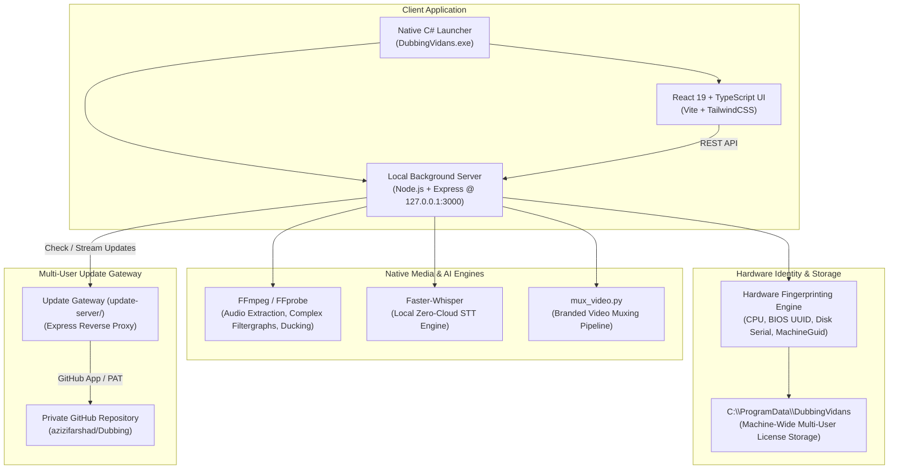

# System Architecture & Technical Specifications

This document outlines the software architecture, cryptographic trust models, core dubbing workflows, and isolation guarantees of **Dubbing Vidans**.

---

## 1. High-Level System Architecture

Dubbing Vidans utilizes a modular, hybrid local-first desktop architecture combining high-performance native desktop execution with a modern reactive web studio.

---

## 2. Core Subsystems

### 2.1 Native Desktop Launcher (`launcher.cs`)
- Compiled via Microsoft .NET Framework C# compiler (`csc.exe`) into `DubbingVidans.exe`.
- Checks for active background processes and detects port conflicts on `PORT 3000`.
- Spawns and manages the lifetime of `server.cjs` in a hidden process window.
- Injects bundled runtime directories (`runtime/python`, `runtime/ffmpeg`) into process `PATH`.
- Launches the system default web browser pointed to `http://127.0.0.1:3000`.
- System tray integration for clean lifecycle control and graceful shutdown.

### 2.2 Local Media Processing Pipeline (`server.ts`)
- **Audio Extraction:** Direct extraction of 44.1kHz / 48kHz stereo WAV from input video containers (MP4, MKV, AVI, MOV).
- **Embedded Subtitle Extraction:** Probing subtitle streams via `ffprobe` and conversion to UTF-8 SRT or JSON.
- **Local Speech Recognition (`local_whisper.py`):** Runs Faster-Whisper offline models locally on CPU or CUDA GPU.
- **Video Branding & Watermarking (`mux_video.py`):** Complex FFmpeg filtergraph concatenating branded video intro, adding logo watermarks, and applying automated audio ducking.

### 2.3 Audio-Video Synchronization Engine (`src/utils/syncEngine.ts`, `overlapEngine.ts`)
- **Zero-Drift Anchoring:** Dialogue start times are never shifted arbitrarily across the timeline.
- **Duration-Aware Candidate Scoring:** Multi-candidate formula balancing semantic accuracy (0.50), naturalness (0.30), and predicted speech duration (0.20).
- **Zero-Silence Trimming:** Trims non-phonation silence buffers from generated TTS segments with 25ms smoothing pads.
- **Pitch-Preserving Time Stretching:** Applies FFmpeg `atempo` filters (bounded between 0.85x and 1.30x) to eliminate overflows without pitch distortion.

---

## 3. Cryptographic Trust & Key Isolation Model

To guarantee the highest level of software protection and operational security, cryptographic keys are strictly isolated into distinct domains:

| Key Domain | Algorithm | Purpose | Location | Protection Guarantee |
| :--- | :--- | :--- | :--- | :--- |
| **Licensing Master Key** | Ed25519 | Offline customer license signing (`.vidanslic`) | Owner workstation only (`tools/license-generator/keys/owner_private_key.pem`) | **NEVER committed to git, NEVER included in CI/CD, NEVER in installers.** |
| **Licensing Master Public Key** | Ed25519 | Client license signature verification | Embedded in `src/utils/licenseConfig.ts` | Strictly preserved (`MCowBQYDK2VwAyEAQtm8JyAAl6Aquc6zfvZ6aHTc6kKp7t+43HXykv0LkM0=`). |
| **Update Signing Key** | Ed25519 | Update manifest signing (`update-manifest.json`) | GitHub Secret `UPDATE_SIGNING_PRIVATE_KEY` / `tools/update-signer/keys/` | Dedicated key; strictly separated from licensing keys. |
| **Update Verification Key** | Ed25519 | Client update manifest verification | Embedded in `src/utils/updateConfig.ts` | Dedicated public key; rejects license authority signatures. |
| **Device Identity Key** | Ed25519 | Client machine activation request signing (`.vidansreq`) | Client machine (`C:\ProgramData\DubbingVidans\device_identity.json`) | AES-256-GCM encrypted using machine-specific hardware key. |
| **GitHub Access Secret** | App / PAT | Accessing private GitHub releases | Server-side only in `update-server/.env` | **ZERO tokens or credentials in client bundles or installers.** |

---

## 4. Machine-Wide Multi-User Data Architecture

On Windows, all license and machine identity data is anchored in:
`C:\ProgramData\DubbingVidans`

- Shared across all Windows user accounts on the machine.
- Retained permanently during application updates, reinstalls, and uninstalls.
- Protected against accidental wipe by Inno Setup installer scripts (`[Dirs]` without `uninsalwaysuninstall`).
- In case of non-Windows or restricted permissions, gracefully falls back to `<appDir>/.license_data`.
