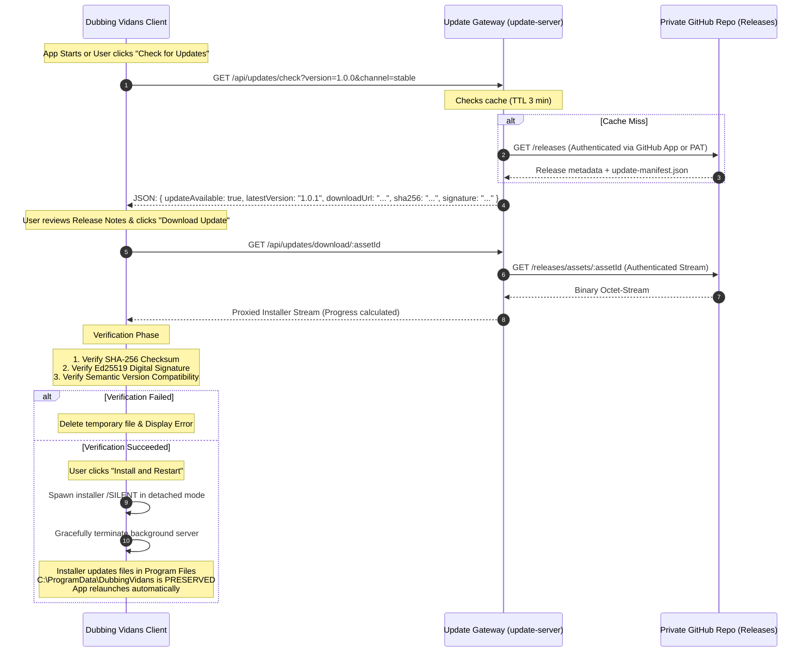

# Secure Multi-User Automatic Update System

This document specifies the multi-user automatic update architecture, verification rules, proxy gateway, and rollback mechanisms of **Dubbing Vidans**.

---

## 1. Problem Statement & Multi-User Requirements

In enterprise software distribution, software releases are hosted inside a private GitHub repository (`azizifarshad/Dubbing`). However:
1. End users **must not** have personal GitHub accounts or access to the private repository.
2. Developer personal access tokens or GitHub App secrets **must never** be compiled into distributed desktop binaries or installers.
3. Users must be able to discover, download, and install authorized updates seamlessly.
4. Application updates **must never** overwrite, reset, or damage existing offline licenses in `C:\ProgramData\DubbingVidans`.

---

## 2. Architecture & Data Flow



---

## 3. Cryptographic Manifest Specification

Every release package is accompanied by a signed `update-manifest.json`:

```json
{
  "schemaVersion": 1,
  "appName": "Dubbing Vidans",
  "version": "1.0.1",
  "channel": "stable",
  "os": "windows",
  "arch": "x64",
  "fileName": "Dubbing-Vidans-Setup.exe",
  "fileSizeBytes": 365010931,
  "sha256": "d65fa10d115f0cb271f70c0f9919f2a0...",
  "minSupportedVersion": "1.0.0",
  "canonicalString": "APP=Dubbing Vidans|VERSION=1.0.1|CHANNEL=stable|OS=windows|ARCH=x64|SHA256=d65fa10d115f0cb271f70c0f9919f2a0...|SIZE=365010931|MIN=1.0.0",
  "signature": "OtZDn2YXFuq8ReoPN7KyANrMGmD8b5jI...",
  "algorithm": "Ed25519",
  "releaseDate": "2026-11-11T10:00:00Z",
  "releaseNotes": "Performance optimizations, security hardening, and stability enhancements.",
  "releaseNotesFa": "بهبودهای سرعت پردازش، ارتقای امنیت سیستم به‌روزرسانی و رفع ایرادات جزئی."
}
```

### Manifest Verification Algorithm:
1. Reconstruct the canonical pipe-delimited string:
   `APP=<app>|VERSION=<version>|CHANNEL=<channel>|OS=<os>|ARCH=<arch>|SHA256=<hash>|SIZE=<size>|MIN=<min>`
2. Cryptographically verify the Ed25519 `signature` using `UPDATE_AUTHORITY_PUBLIC_KEY_PEM`.
3. Compute the SHA-256 hash of the downloaded `.exe` binary.
4. Compare calculated hash with manifest `sha256`. If they do not match, the package is immediately deleted.

---

## 4. Rollback and Safe Installation Strategy

1. **Staging:** Updates are downloaded into an isolated temporary folder (`<appDir>/updates/`).
2. **Preservation:** User projects, active configurations, and machine licensing keys (`C:\ProgramData\DubbingVidans`) are never overwritten.
3. **Execution Safety:** The installer is executed with `/SILENT` in a detached child process, allowing the main application to close file locks gracefully before binary replacement begins.
4. **Failure Recovery:** If installation fails or is aborted, the original installation in `C:\Program Files\Dubbing Vidans` remains intact.
