# CI/CD Workflows & Build Automation Guide

This document describes the automated testing, continuous integration, and release delivery pipelines configured in **Dubbing Vidans**.

---

## 1. Pipeline Overview

GitHub Actions workflows are partitioned into three dedicated workflows to separate fast developer checks from heavy native Windows builds:

```mermaid
flowchart TD
    Commit[Git Push / PR] --> CI[Continuous Integration\n.github/workflows/ci.yml]
    CI --> Lint[Lint & Typecheck\ntsc --noEmit]
    CI --> TestCI[Lightweight Test Suite\nnpm run test:ci]
    CI --> Build[Build Frontend & Backend\nnpm run build]
    CI --> ArtifactCheck[Verify Artifacts\ndist/ & server.cjs]

    WindowsTrigger[Push with native files / Manual] --> WinInt[Windows Integration\n.github/workflows/windows-integration.yml]
    WinInt --> CscCompile[Compile C# Launcher\ncsc.exe -> DubbingVidans.exe]
    WinInt --> HeavyTests[Windows Integration Tests\nnpm run test:integration]
    WinInt --> InnoTest[Compile Test Inno Setup Installer]

    TagTrigger[Push Tag v*.*.* / Manual] --> CD[Release Automation\n.github/workflows/release.yml]
    CD --> EnforceTest[Enforce Zero Regressions\nnpm run test:ci]
    CD --> FullBuild[Build Web & Server]
    CD --> LauncherBuild[Compile Launcher]
    CD --> InnoBuild[Compile Standalone Installer\nISCC.exe]
    CD --> SignManifest[Sign Update Manifest\npython sign_release.py]
    CD --> PublishRelease[Publish Private GitHub Release\nwith SHA256 & Manifest]
```

---

## 2. Workflow Specifications

### 2.1 Continuous Integration (`.github/workflows/ci.yml`)
- **Triggers:** Pushes to `main`, release branches, and all pull requests.
- **Environment:** `windows-latest`.
- **Execution Time:** ~2 minutes.
- **Security:** Requires **zero secrets**. Production licensing private keys are never required.
- **Steps:**
  1. Source checkout (`actions/checkout@v4`).
  2. Setup Node.js 22 and Python 3.11.
  3. Install dependencies via `npm ci` and `pip install cryptography`.
  4. Typecheck via `npm run lint` (`tsc --noEmit`).
  5. Run fast lightweight test suite via `npm run test:ci`:
     - Audio-Video synchronization engine (`syncEngine.test.ts`).
     - Balanced duration dubbing system (`balancedDubbingSystem.test.ts`).
     - Overlap management & bulk speed control (`overlapAndBulkSpeed.test.ts`).
     - Timeline auto-fix and adaptive speed (`autoFixTimeline.test.ts`).
     - Zero-silence trimming & flexible placement (`zeroSilenceAndFlexiblePlacement.test.ts`).
     - Hormouz LLM JSON extraction & repair (`hormouzJsonExtractor.test.ts`).
     - Licensing system with ephemeral Ed25519 test keys (`licensingSystem.test.ts`).
     - Auto-update subsystem with key isolation checks (`autoUpdateSystem.test.ts`).
  6. Compile Vite frontend and backend bundle (`npm run build`).
  7. Validate presence of `dist/index.html` and `server.cjs`.

### 2.2 Windows Integration Validation (`.github/workflows/windows-integration.yml`)
- **Triggers:** Changes to `launcher.cs`, `installer/**`, `mux_video.py`, or manual dispatch.
- **Steps:**
  1. Set up Node, Python (with `soundfile`, `numpy`, `cryptography`), and FFmpeg.
  2. Compile C# launcher `DubbingVidans.exe` with `csc.exe`.
  3. Run integration tests `npm run test:integration` (video branding pipeline and offline metrics).
  4. Install Inno Setup 6 and test-compile `installer/DubbingVidans_Setup.iss`.

### 2.3 Continuous Delivery & Release (`.github/workflows/release.yml`)
- **Triggers:** Pushed Git tag matching `v*` (e.g. `v1.0.1`) or manual `workflow_dispatch`.
- **Permissions:** `contents: write` (to upload release assets).
- **Secrets Used:**
  - `UPDATE_SIGNING_PRIVATE_KEY`: Ed25519 private key used to sign `update-manifest.json`.
  - `GITHUB_TOKEN`: Standard short-lived Actions token to attach assets to the private release.
- **Steps:**
  1. Extract version from Git tag or manual dispatch input.
  2. Enforce zero regressions via `npm run test:ci`.
  3. Compile Vite client and standalone server bundle.
  4. Compile native launcher `DubbingVidans.exe`.
  5. Compile standalone installer `dist-installer/Dubbing-Vidans-Setup.exe` with Inno Setup.
  6. Sign installer and generate `update-manifest.json` and `sha256sums.txt` using `tools/update-signer/sign_release.py`.
  7. Publish private GitHub Release with installer, manifest, and checksum files.

---

## 3. Required GitHub Secrets Configuration

| Secret Name | Required By | Description |
| :--- | :--- | :--- |
| `UPDATE_SIGNING_PRIVATE_KEY` | `release.yml` | PEM-encoded Ed25519 private key for signing update manifests. **Never use the licensing key.** |
| `GITHUB_TOKEN` | `release.yml` | Automatically provided by GitHub Actions with `contents: write` permission. |
