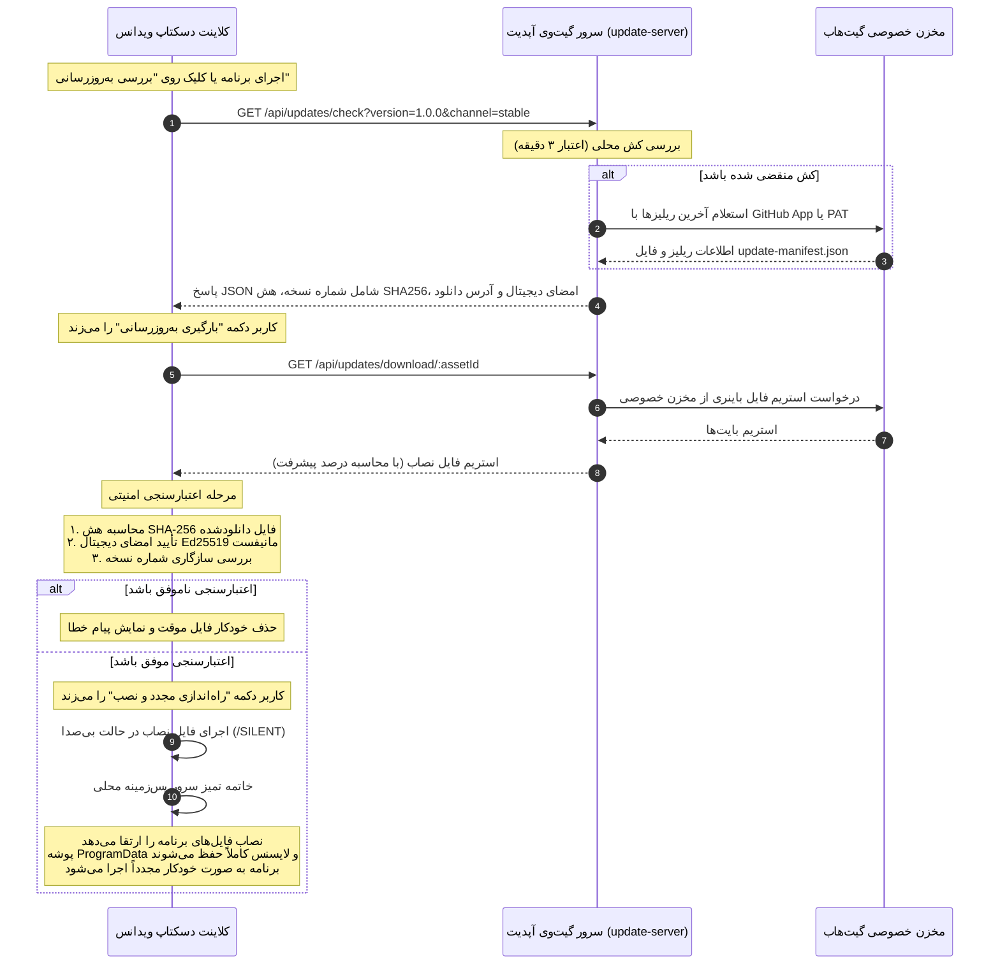

# زیرساخت به‌روزرسانی خودکار و چندکاربره امن

این سند تشریح‌کننده معماری توزیع به‌روزرسانی، گیت‌وی احراز هویت سرور و فرآیند نصب امن و بدون از دست رفتن اطلاعات برای کاربران **دوبله ویدانس** است.

---

## ۱. صورت مسئله و مدل توزیع چندکاربره

در نرم‌افزارهای تجاری اختصاصی، مخزن کدهای منبع در گیت‌هاب کاملاً خصوصی (`Private`) است. بنابراین:
۱. کاربران نهایی نباید هیچ نیازی به داشتن حساب کاربری در گیت‌هاب داشته باشند.
۲. هیچ‌گونه توکن دسترسی به گیت‌هاب یا کلید محرمانه نباید درون کدهای کلاینت دسکتاپ قرار گیرد.
۳. بسته‌های جدید باید به صورت خودکار شناسایی و دانلود شوند.
۴. به‌روزرسانی نرم‌افزار تحت هیچ شرایطی نباید لایسنس موجود در `C:\ProgramData\DubbingVidans` را از بین ببرد.

---

## ۲. جریان تبادل اطلاعات و استریم امن فایل‌ها



---

## ۳. ساختار مانیفست امضاشده (`update-manifest.json`)

هر بسته آپدیت دارای مانیفست اختصاصی با ساختار زیر است:

```json
{
  "schemaVersion": 1,
  "appName": "Dubbing Vidans",
  "version": "1.0.1",
  "channel": "stable",
  "os": "windows",
  "arch": "x64",
  "fileName": "Dubbing-Vidans-Setup.exe",
  "fileSizeBytes": 365010931,
  "sha256": "d65fa10d115f0cb271f70c0f9919f2a0...",
  "minSupportedVersion": "1.0.0",
  "canonicalString": "APP=Dubbing Vidans|VERSION=1.0.1|CHANNEL=stable|OS=windows|ARCH=x64|SHA256=d65fa10d115f0cb271f70c0f9919f2a0...|SIZE=365010931|MIN=1.0.0",
  "signature": "OtZDn2YXFuq8ReoPN7KyANrMGmD8b5jI...",
  "algorithm": "Ed25519",
  "releaseDate": "2026-11-11T10:00:00Z",
  "releaseNotes": "Performance optimizations and stability enhancements.",
  "releaseNotesFa": "بهبودهای سرعت پردازش، ارتقای امنیت سیستم به‌روزرسانی و رفع ایرادات جزئی."
}
```

---

## ۴. استراتژی بازگشت (Rollback) و پایداری داده‌ها

۱. **عدم تخریب داده‌های کاربری:** مسیر نصب (`Program Files\Dubbing Vidans`) کاملاً از مسیر داده‌ها و لایسنس (`C:\ProgramData\DubbingVidans`) مجزاست.
۲. **بررسی صحت قبل از اجرا:** اگر فایل دانلودشده ناقص یا خراب باشد، بلافاصله پاک شده و پروسه ارتقا آغاز نمی‌شود.
۳. **بازیابی خودکار:** در صورت توقف فرآیند نصب، نسخه پیشین بدون مشکل در دسترس کاربر باقی می‌ماند.
