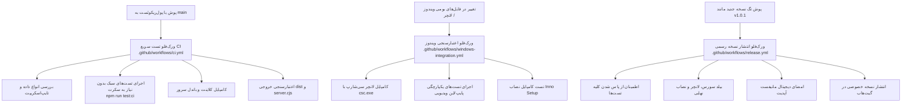

# خط‌لوله ادغام مداوم (CI/CD) و خودکارسازی انتشارات

این سند سازوکار تست‌های خودکار، ورک‌فلوهای گیت‌هاب اکشنز و تولید نسخه‌های رسمی نرم‌افزار **دوبله ویدانس** را توضیح می‌دهد.

---

## ۱. تفکیک تست‌های سبک از بیلد بومی ویندوز

با توجه به الزامات پایداری، پایپ‌لاین به سه ورک‌فلو تفکیک شده است:

---

## ۲. مشخصات و وظایف هر ورک‌فلو

### ۲.۱ ورک‌فلو ادغام مداوم (`ci.yml`)
- اجرا با هر پوش یا درخواست پول‌ریکوئست بر روی شاخه `main`.
- بدون نیاز به هیچ‌گونه کلید یا رمز محرمانه.
- اجرای تست‌های منطق هماهنگ‌سازی، ترجمه، ضد دستکاری لایسنس و زیرسیستم آپدیت.

### ۲.۲ اعتبارسنجی محیط ویندوز (`windows-integration.yml`)
- کامپایل فایل `launcher.cs` با استفاده از کامپایلر رسمی دات‌نت `csc.exe` و تولید `DubbingVidans.exe`.
- بررسی کارکرد فیلترهای FFmpeg در اسکریپت `mux_video.py`.
- تست اسکریپت نصاب Inno Setup در محیط بومی ویندوز سرور.

### ۲.۳ ورک‌فلو انتشار خودکار (`release.yml`)
- فعال‌سازی با پوش تگ نگارش جدید (مثل `v1.0.1`).
- ساخت بسته نصاب ویندوز `Dubbing-Vidans-Setup.exe`.
- فراخوانی `tools/update-signer/sign_release.py` با استفاده از سکرت `UPDATE_SIGNING_PRIVATE_KEY`.
- استخراج هش SHA-256 و تولید `update-manifest.json` و `sha256sums.txt`.
- بارگذاری امن فایل‌ها در بخش Releases مخزن خصوصی.

---

## ۳. تنظیم سکرت‌های مورد نیاز در گیت‌هاب

| نام سکرت | محل استفاده | شرح عملکرد |
| :--- | :--- | :--- |
| `UPDATE_SIGNING_PRIVATE_KEY` | `release.yml` | کلید خصوصی Ed25519 جهت امضای دیجیتال فایل `update-manifest.json`. **هرگز کلید لایسنس مالک در این بخش وارد نشود.** |
| `GITHUB_TOKEN` | `release.yml` | توکن سیستمی گیت‌هاب جهت آپلود فایل‌های بسته نصابی روی ریلیز مخزن خصوصی. |
