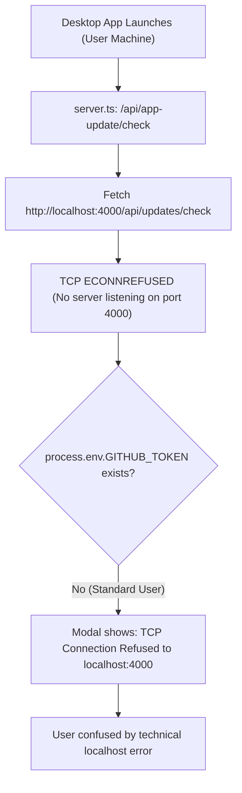
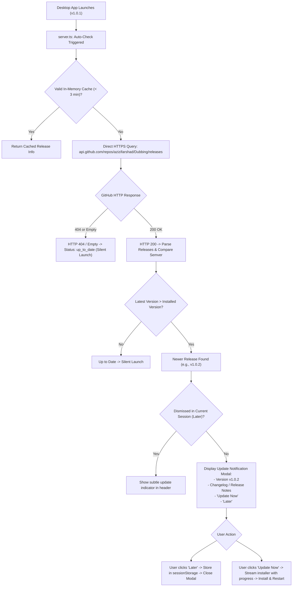

# 01. Current Update System Analysis & Root Cause Post-Mortem

## 1. Executive Summary

This report documents the in-depth architectural analysis and root cause investigation of the update check failure in the Dubbing Vidans desktop application:
```text
TCP Connection Refused (ECONNREFUSED) to http://localhost:4000/api/updates/check?version=1.0.1&channel=stable&os=win&arch=x64
```
The investigation identified three fundamental architectural defects in the legacy update subsystem, explained below in detail.

---

## 2. Root Cause Analysis

### 2.1 Hardcoded Dependency on Local Update Server (`localhost:4000`)

In `server.ts` (lines 2990 and 3209 of the legacy code):
```typescript
const UPDATE_SERVER_URL = process.env.UPDATE_SERVER_URL || 'http://localhost:4000';
...
const checkUrl = `${UPDATE_SERVER_URL}/api/updates/check?version=${appUpdateState.currentVersion}&channel=${reqChannel}&os=win&arch=x64`;
```

#### Why Did This Exist?
The project previously contained an auxiliary sub-project in the `update-server/` directory. That sub-project was written as a standalone proxy gateway intended to be deployed in Docker or on a cloud server (e.g., Render, Railway, VPS) with an embedded `GITHUB_TOKEN` to act as an authenticated bridge to a private GitHub repository.

#### Why Did It Fail on End-User Machines?
End users run the compiled desktop application (`Dubbing-Vidans-Setup.exe`). End users do not run Docker containers or Node.js servers on port 4000 on their local computers. Consequently, whenever the desktop application attempted to check for updates, Node.js executed an HTTP GET request to `http://localhost:4000`, which immediately failed at the TCP socket layer with `ECONNREFUSED`.

---

### 2.2 Token-Gated GitHub Fallback

In the legacy `server.ts` code, a fallback to GitHub Releases was attempted, but it was strictly gated behind an environment variable check:
```typescript
// Legacy fallback in server.ts
if (process.env.GITHUB_TOKEN && process.env.GITHUB_TOKEN.trim()) {
  try {
    const ghRes = await fetch('https://api.github.com/repos/azizifarshad/Dubbing/releases?per_page=10', {
      headers: {
        Authorization: `token ${process.env.GITHUB_TOKEN.trim()}`,
        ...
      }
    });
    ...
  } catch (ghErr) { ... }
}
```

#### Why Was This a Flaw?
1. **Zero Client Credentials Rule**: End users of a distributed desktop software do not (and must not) have a GitHub Personal Access Token (PAT) configured in their local `.env`.
2. Public GitHub repositories do not require any token to query `https://api.github.com/repos/OWNER/REPO/releases` or to download release assets.
3. Because `GITHUB_TOKEN` was undefined on user machines, the entire fallback block was skipped, and the client was presented with the raw `ECONNREFUSED` error from `localhost:4000`.

---

### 2.3 Fragile Handling of Empty Releases & HTTP 404

When querying GitHub Releases on a repository that has not yet published any release tags, or on a private repository without credentials:
- GitHub's REST API returns `HTTP 404 Not Found`.
- The legacy code treated HTTP 404 as an unhandled error, logging warnings and returning error states to the frontend.
- A proper update subsystem must treat `HTTP 404` or an empty release list as **"Application is currently up to date"**, allowing the application to launch silently without user disruption.

---

### 2.4 User Experience (UX) Limitations in Prior Implementation

1. **Passive Badge vs. Active Prompt**: On startup, `App.tsx` merely polled `/api/app-update/status`. Even if an update had been detected, it only lit up a small indicator in the header rather than presenting the user with an actionable update dialog.
2. **Missing Session Dismissal ("Later")**: The interface lacked a session-level dismissal mechanism. If an update notification appeared, closing it would repeatedly reappear on subsequent state changes during the same session.
3. **No Direct Public Binary URL**: Asset downloads routed through an authenticated streaming proxy (`/api/app-update/download-asset/:assetId`) which again failed without a GitHub token, instead of leveraging GitHub's native `browser_download_url` for public releases.

---

## 3. Comparison of Update Architectures

### 3.1 Legacy Broken Architecture



### 3.2 New Direct GitHub Releases Architecture


