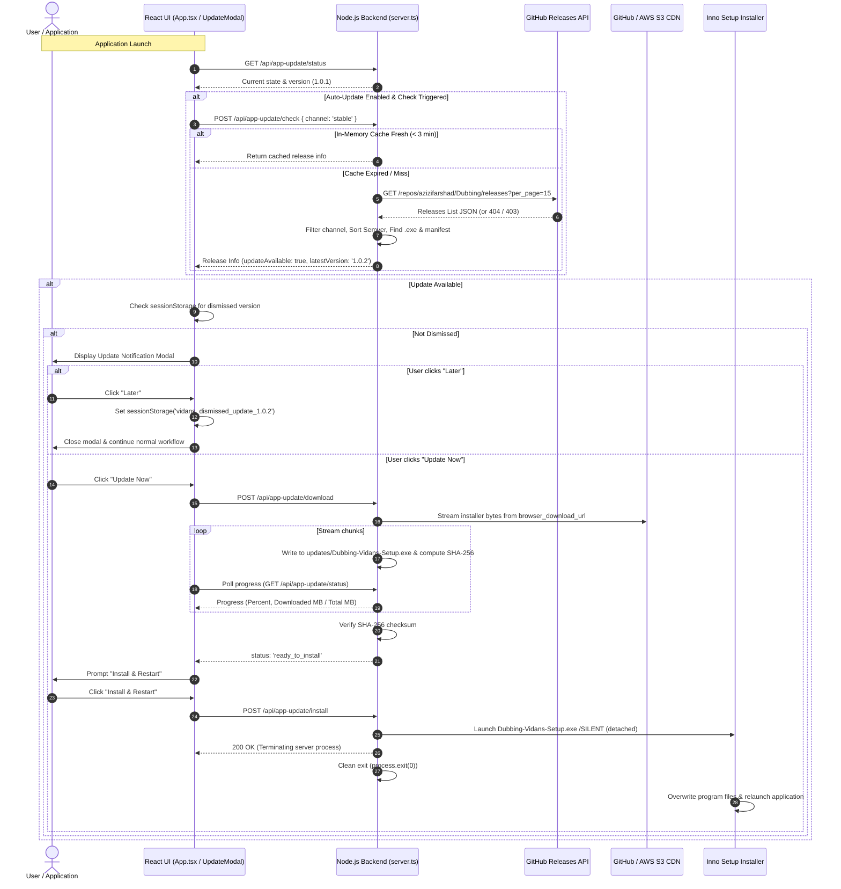

# 02. GitHub-Based Auto-Update Architecture

## 1. Architectural Principles

The updated auto-update subsystem in Dubbing Vidans is built upon five foundational principles:

1. **Direct GitHub Releases Source**: No third-party or local intermediary server is required. Releases are queried directly from the official repository `https://github.com/azizifarshad/Dubbing`.
2. **Zero-Credential End-User Access**: Unauthenticated access to public GitHub Releases API allows every client to check for and download updates without personal access tokens.
3. **Resilient Rate-Limit Protection**: Built-in 3-minute in-memory caching ensures that repeated user clicks or background checks do not exceed GitHub's unauthenticated IP rate limit (60 requests/hour).
4. **Non-Intrusive User Experience**: Seamless background checks on launch; silent continuation if up to date or offline; and one-click session dismissal ("Later") if the user is busy.
5. **Robust Packaging & Cryptographic Validation**: Automatic discovery of the Windows x64 installer executable (`Dubbing-Vidans-Setup.exe`), verification of SHA-256 hashes, and optional Ed25519 digital signature verification.

---

## 2. Component Architecture

---

## 3. Key Subsystems and Logic

### 3.1 Semantic Versioning (SemVer) Engine

Version comparison is implemented using numeric segment comparisons rather than alphabetical strings:
- Strips leading `v` prefixes (`v1.0.2` $\to$ `1.0.2`).
- Splits version into major, minor, and patch numbers (`[major, minor, patch]`).
- Compares each segment numerically from left to right.
- Correctly evaluates non-alphabetical versions:
  $$\text{"1.0.10"} > \text{"1.0.9"}$$
  $$\text{"1.1.0"} > \text{"1.0.10"}$$
  $$\text{"2.0.0"} > \text{"1.99.99"}$$
- Supports pre-release tags (`1.0.0` > `1.0.0-beta`).

### 3.2 Channel Model (`stable` vs. `beta`)

- **Stable Channel (Default)**:
  Filters releases strictly by `!r.draft && !r.prerelease`. End users receive only finalized, battle-tested software releases.
- **Beta Channel**:
  Filters releases by `!r.draft`. Allows users who opt-in to test pre-release builds and preview upcoming features.

### 3.3 Release Asset Discovery

When a release is inspected on GitHub, assets are matched using deterministic pattern rules:
1. **Windows Installer Package**:
   Searches `release.assets` for files ending in `.exe`, prioritizing names matching `Dubbing-Vidans-Setup*.exe` and ignoring administrative utilities (such as `LicenseGenerator.exe`).
2. **Cryptographic Manifest (`update-manifest.json`)**:
   Optional JSON asset published alongside the installer. If present, it provides:
   - `sha256`: Expected SHA-256 hash of the installer.
   - `signature`: Ed25519 digital signature of the release metadata.
   - `releaseNotesFa`: Native Persian changelog.
   - `minSupportedVersion`: Minimum baseline version for direct upgrades.
3. **Fallback to Direct GitHub Download**:
   If no manifest is published, the release's `browser_download_url` and markdown `body` are utilized directly.

### 3.4 Rate Limiting & Offline Protection

- **3-Minute Caching**: Results from GitHub are stored in memory for 180 seconds. Rapidly opening and closing the settings or update modal consumes 0 additional GitHub API calls.
- **Rate Limit Handlers**: If GitHub returns `HTTP 403` (rate limit exceeded), the system sets `isRetryable: true` and informs the user gracefully without technical jargon.
- **Offline / Network Fault Isolation**: If the user has no internet connection, or if DNS fails (`ENOTFOUND`), the error is captured silently during background launch checks. The application never prevents the user from working offline.
