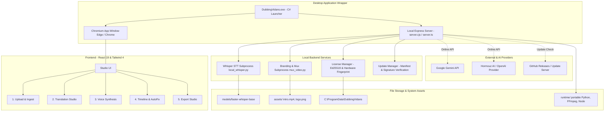

# 01 - Project Overview: Dubbing Vidans

## Executive Overview

**Dubbing Vidans** (استودیو دوبله هوشمند فارسی ویدانس) is an enterprise-grade, offline-capable desktop and web studio for automated Persian video dubbing, subtitle translation, speech-to-text transcription, and intelligent audio-video timeline synchronization.

The application bridges artificial intelligence with professional video post-production workflows. It takes an English or foreign language video, extracts or transcribes speech, translates the dialogues into natural, culturally adapted Persian, synthesizes studio-quality speech, intelligently stretches and aligns the audio waveforms to match video scene timing and lip movement, and multiplexes the result into a fully branded, publication-ready MP4 video.

---

## Key Highlights & Capabilities

### 1. Dual AI Engine Architecture (Cloud & 100% Offline)
- **Cloud Mode**: Integrates with Google Gemini API (`@google/genai` 2.4+ / Gemini 3.8 Flash, Flash-Lite) and Hormouz AI / OpenAI-compatible endpoints (`openai/gpt-6-luna`, `api.hormouz.net`).
- **Offline Mode**: Operates completely disconnected from the internet. Employs local CTranslate2 `faster-whisper` models (`base` model bundled locally), an internal rule-based Persian translation engine with specialized technical dictionaries, and procedural Web Audio synthesis for preview tracking.

### 2. Five-Stage Integrated Dubbing Workflow
The application guides creators through an intuitive 5-step pipeline:
1. **File Ingestion & Audio/Subtitle Extraction**:
   - Ingests video (`MP4`, `MKV`, `WebM`, `AVI`) and audio (`WAV`, `MP3`).
   - Direct FFmpeg extraction of embedded subtitle tracks (`.srt`) without transcoding.
   - Offline speech-to-text with word-level timestamps using Faster-Whisper.
   - Cloud speech-to-text with Gemini Multimodal Audio API.
2. **Translation & Candidate Scoring Studio**:
   - Translates English subtitles into Persian with 3 distinct candidate categories:
     - *Faithful* (وفادار): High semantic precision.
     - *Concise* (خلاصه و فشرده): Optimized for tight visual timing constraints.
     - *Conversational* (محاوره‌ای روان): Natural Persian dialogue.
   - Acoustic duration prediction before TTS synthesis based on Persian syllable, phoneme, and pause analysis.
   - Weighted multi-candidate scoring: $0.50 \times \text{Semantic} + 0.30 \times \text{Naturalness} + 0.20 \times \text{Duration}$.
   - Semantic guardrails: Automated validation to prevent critical negation flipping and missing numeric values.
3. **Voice Synthesis Studio**:
   - Multi-speaker voice assignment (supports multiple distinct characters).
   - Calibrated voice profiles (`Puck`, `Charon`, `Kore`, `Fenrir`, `Zephyr`, `Iapetus`).
   - Syllable rate calibration and duration delta tracking.
4. **Interactive Timeline & Auto-Fix Engine**:
   - Multi-track visual timeline with zoom, pan, scrubbing, and waveform display.
   - 6-stage automated timeline repair engine (`autoFixEngine.ts`):
     - Stage 1: Full audio profiling (digital dead silence vs vocal phonation onset/offset).
     - Stage 2: Collision & overlap classification (intentional multi-speaker overlaps vs unintended collisions).
     - Stage 3: Zero-silence trimming (15ms attack cushion, 30ms release cushion).
     - Stage 4: Flexible placement shifting into safe pre-gap or post-gap.
     - Stage 5: Discrete adaptive tempo stretching (1.00x, 1.10x, 1.20x, max 1.30x) using WSOLA (Waveform Similarity Overlap-Add).
     - Stage 6: Persian translation shortening if timing constraints remain unresolvable.
   - Non-destructive operation with full 1-click snapshot undo.
5. **Export & Branding Studio**:
   - Multi-channel audio mixing and resampling (FLTP stereo 48,000 Hz, AAC 192 kbps).
   - Automated video branding pipeline (`mux_video.py`):
     - Concatenation of high-definition 1080p studio intro video (`assets/cache/intro_normalized_1080p.mp4`).
     - Dynamic corner watermark logo overlay with aspect ratio preservation.
     - Hardware-accelerated H.264 video encoding with fast-start flags for web streaming.

### 3. Enterprise Hardware-Bound Offline Licensing
- Cryptographic asymmetric signature scheme using **Ed25519**.
- Zero cloud dependency: validates offline against an embedded master public key.
- Hardware fingerprinting: collects Windows `MachineGuid`, BIOS UUID, CPU ID, Motherboard serial, and Disk serial to prevent unauthorized machine transfers.
- Activation workflow: client generates an activation request (`.vidansreq`), software owner issues a permanent license (`.vidanslic`) via a standalone GUI generator (`LicenseGenerator.exe`), and the license is installed machine-wide into `%ProgramData%\DubbingVidans`.

### 4. Cryptographically Signed Auto-Update System
- Automated update checking against GitHub Releases or private update proxy (`update-server`).
- Ed25519 digital signature verification on release manifests (`update-manifest.json`).
- SHA-256 binary checksum validation prior to execution.
- Strict cryptographic key isolation: dedicated update-signing key pair completely separated from licensing keys.

### 5. Native Windows Integration & Portability
- Native C# Windows launcher (`launcher.cs` compiled to `DubbingVidans.exe`) launching a dedicated, clean, kiosk-style desktop window using Microsoft Edge or Google Chrome (`--app` mode).
- Self-contained portable runtime (`runtime/`) bundling Node.js, Python 3.12, FFmpeg, and FFprobe.
- Professional Inno Setup installer (`installer/DubbingVidans_Setup.iss`) compiling a single standalone installer (`Dubbing-Vidans-Setup.exe`).

---

## Technical Specifications

| Parameter | Specification |
| :--- | :--- |
| **Product Name** | Dubbing Vidans (استودیو دوبله هوشمند ویدانس) |
| **Version** | 1.0.1 (Semantic Versioning) |
| **Architecture** | Client-Server Hybrid (React SPA + Local Node.js / Express Server + Python AI Engines) |
| **Frontend Framework** | React 19, TypeScript 5.8 / 7.0, Vite 8.3, Tailwind CSS 4.3, Motion (Framer) 12.23, Lucide React |
| **Backend Runtime** | Node.js 18+ / 22 LTS, Express 4.21, TypeScript execution via `tsx` or bundled `server.cjs` via `esbuild` |
| **AI / ML Stack** | Google GenAI SDK (`@google/genai` 2.4+), Faster-Whisper (CTranslate2), PyDub, SoundFile, NumPy |
| **Media Processing** | FFmpeg 7.x / 6.x, FFprobe, Web Audio API, WSOLA Time-Stretch Algorithm |
| **Cryptography** | Ed25519 Asymmetric Signatures, SHA-256 Hashing, AES-256-GCM Encryption |
| **Target OS** | Microsoft Windows 10 / 11 (64-bit x64), with Linux/macOS launcher compatibility |
| **Repository URL** | `https://github.com/azizifarshad/Dubbing.git` |
| **Current Git Branch** | `main` (In sync with `origin/main`) |

---

## System Component Diagram

