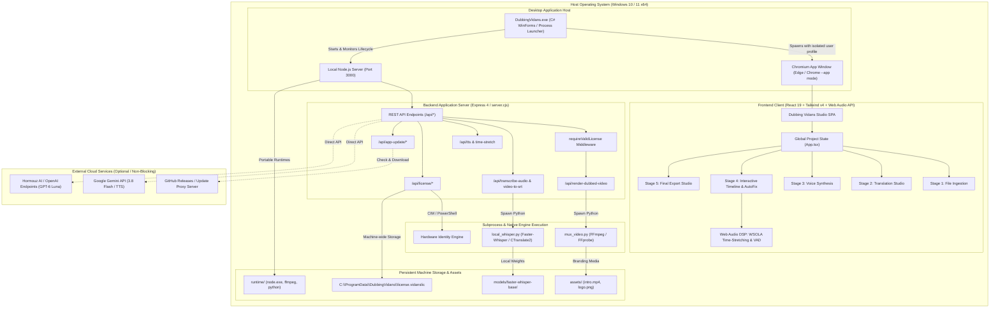
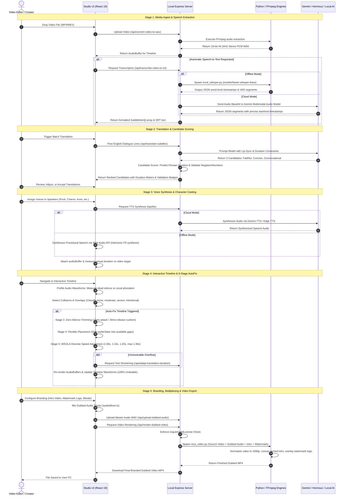
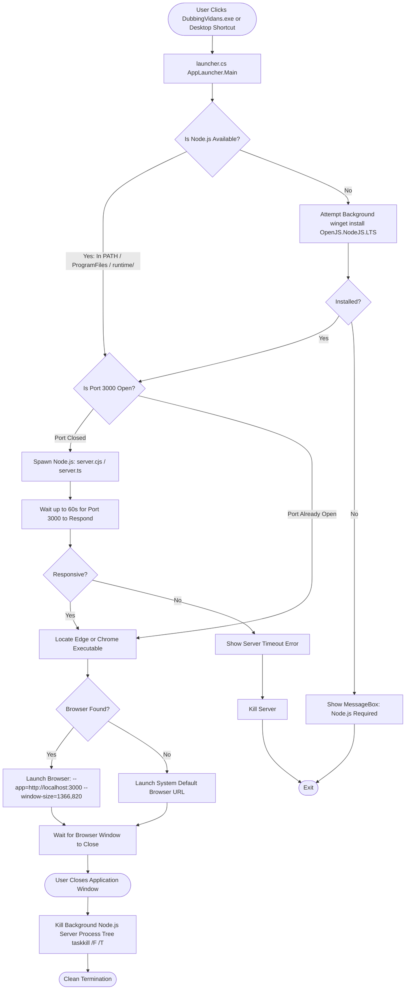
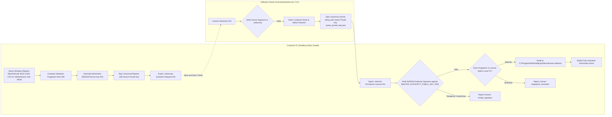
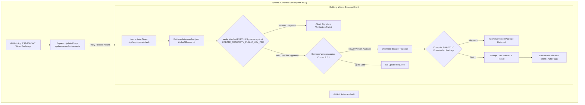
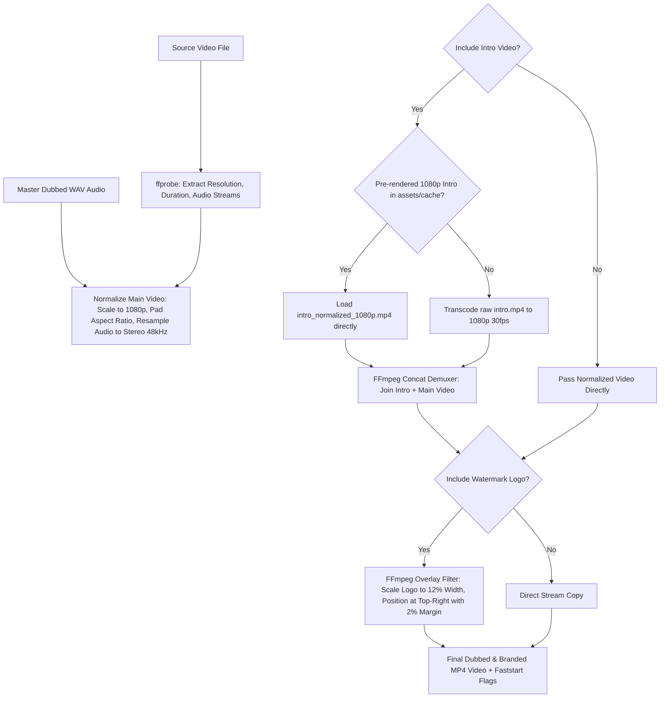

# 04 - Application Architecture & End-to-End Workflow

## Executive Summary

**Dubbing Vidans** employs a hybrid client-server desktop architecture designed for resilience, modularity, and complete offline capability.

Rather than relying on resource-intensive frameworks like Electron, Dubbing Vidans utilizes a lightweight **Native C# Process Host** (`launcher.cs` / `DubbingVidans.exe`) that starts an isolated local Node.js Express server (`server.cjs`) and embeds the web application inside a dedicated Microsoft Edge or Google Chrome application window (`--app` mode).

This document details the architectural layers, system workflows, data flows, persistence mechanisms, and cryptographic security models of the application.

---

## 1. System Architecture Overview

---

## 2. End-to-End Application Workflow

The primary business workflow transitions through five consecutive post-production stages:

---

## 3. Application Startup Process

---

## 4. Offline Cryptographic Licensing Architecture

The licensing subsystem guarantees 100% offline verification while locking the software to the customer's physical computer.

### Deterministic Canonical String Serialization

To prevent JSON formatting discrepancies from invalidating cryptographic signatures across platforms, deterministic pipe-separated canonical strings are strictly used:

1. **Activation Request Canonical String**:
   $$\text{PRODUCT}=\dots|\text{VERSION}=1|\text{FINGERPRINT}=\dots|\text{DEVICE\_KEY}=\dots|\text{MACHINE}=\dots|\text{REQUESTED\_AT}=\dots$$

2. **Permanent License Canonical String**:
   $$\text{PRODUCT}=\dots|\text{VERSION}=1|\text{ID}=\dots|\text{CUSTOMER}=\dots|\text{FINGERPRINT}=\dots|\text{DEVICE\_KEY}=\dots|\text{TYPE}=\dots|\text{ISSUED}=\dots|\text{FEATURES}=\text{sorted,comma,separated}$$

---

## 5. Auto-Update Subsystem Architecture

The auto-update subsystem allows secure distribution of software patches from private or public GitHub repositories without embedding credentials in distributed client builds.

---

## 6. Video Branding & Multiplexing Pipeline

`mux_video.py` orchestrates the final media production stage, implementing aspect-ratio preservation and high-speed intro concatenation:

---

## 7. Data Persistence Architecture

Dubbing Vidans implements a four-tier data storage hierarchy:

| Storage Tier | Location | Contents | Persistence Lifecycle |
| :--- | :--- | :--- | :--- |
| **Machine-Wide System Storage** | `C:\ProgramData\DubbingVidans` | Permanent license (`license.vidanslic`), device identity (`device_identity.json`), shared model weights | Permanent across all Windows users; preserved during software upgrades |
| **User Application Data** | `%LOCALAPPDATA%\DubbingVidans\UserData` | Chromium profile, session storage, browser cache | User-specific; managed by Windows process launcher |
| **Browser Local Storage** | `localStorage` | API Keys (`persian_dub_api_key`), Base URL, selected models, update check preferences | Client-side; persists across browser sessions |
| **Operating System Temp Storage** | `%TEMP%` (`os.tmpdir()`) | Temporary audio chunks, intermediate WAV mixes, FFmpeg video segments | Ephemeral; automatically cleaned up after API response completion |
