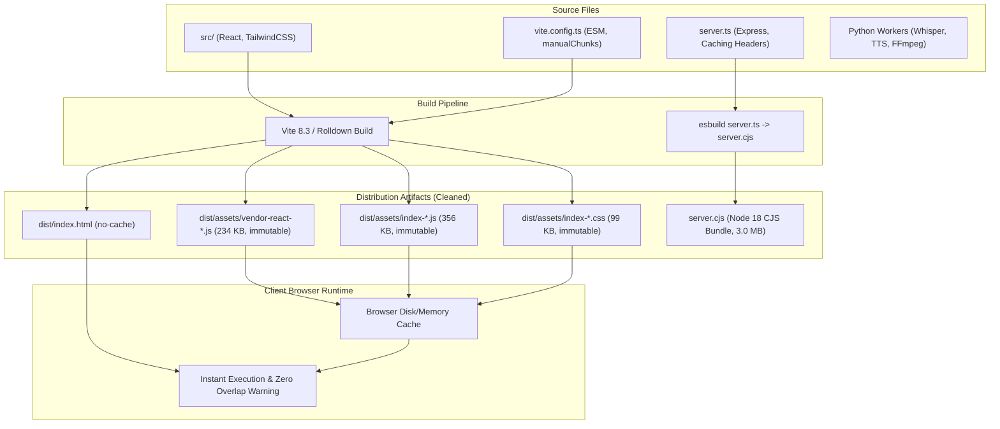
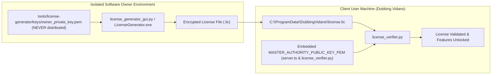

# 04. Code and Architecture Optimizations

## 1. Executive Summary

This document details the architectural, structural, and code-level optimizations performed during the Dubbing Vidans system audit and cleanup. Every code modification was executed to resolve existing compile/lint issues, enhance runtime efficiency, eliminate bundle warnings, eliminate duplicate asset dependencies, and safeguard cryptographic key isolation.

---

## 2. Detailed Code and Architecture Modifications

### 2.1 TypeScript Type Alignment & Linter Fix (`server.ts`)

#### Problem Statement
Running `npm run lint` (`tsc --noEmit`) previously terminated with error `TS2561`:
```text
server.ts(3574,9): error TS2561: Object literal may only specify known properties, 
but 'errorMessageFa' does not exist in type '{ status: ...; errorMessage?: string; ... }'
```
The error was caused by an omission in `interface AppUpdateState`: the update downloader assigned `errorMessageFa: classified.messageFa`, which frontend component `UpdateModal.tsx` expects, but the TypeScript interface definition only declared `errorMessage?: string`.

#### Solution Applied
In `server.ts`, lines 3093–3107:
```typescript
interface AppUpdateState {
  currentVersion: string;
  channel: 'stable' | 'beta';
  autoUpdateEnabled: boolean;
  updateInfo: any | null;
  progress: {
    status: 'idle' | 'checking' | 'available' | 'up_to_date' | 'downloading' | 'downloaded' | 'verifying' | 'ready_to_install' | 'installing' | 'error';
    progressPercent: number;
    downloadedBytes: number;
    totalBytes: number;
    errorMessage?: string;
    errorMessageFa?: string;       // <-- Added to satisfy TS2561 and synchronize with UI
    technicalDetails?: string;
  };
  downloadedFilePath: string | null;
}
```
**Outcome**: `npm run lint` now passes with `0 errors` and clean exit status code 0.

---

### 2.2 Vite & Rolldown Bundler Modernization (`vite.config.ts`)

#### Problem Statement
1. **ES Module Warning**: `vite.config.ts` referenced Node's legacy `__dirname` global:
   ```text
   (!) Your Vite config uses features that are unsupported by configLoader: 'native'
     - __dirname (vite.config.ts:11:22). Use import.meta.dirname instead
   ```
2. **Monolithic Bundle Warning**: Vite built the entire application frontend into a single `589.65 kB` JavaScript bundle (`dist/assets/index-BvVIXrMR.js`), triggering chunk size warnings (>500 kB).

#### Solution Applied
We updated `vite.config.ts` to:
1. Use native ESM `import.meta.dirname`.
2. Configure `build.rollupOptions.output.manualChunks` using a function (matching Rolldown's modern API requirements in Vite 8) to isolate vendor packages into distinct chunks:

```typescript
import tailwindcss from '@tailwindcss/vite';
import react from '@vitejs/plugin-react';
import path from 'path';
import { defineConfig } from 'vite';

const rootDir = import.meta.dirname;

export default defineConfig(() => {
  return {
    plugins: [react(), tailwindcss()],
    resolve: {
      alias: {
        '@': path.resolve(rootDir, '.'),
      },
    },
    build: {
      rollupOptions: {
        output: {
          manualChunks(id: string) {
            if (id.includes('node_modules')) {
              if (id.includes('react') || id.includes('react-dom') || id.includes('scheduler')) {
                return 'vendor-react';
              }
              if (id.includes('lucide-react')) {
                return 'vendor-icons';
              }
              if (id.includes('framer-motion') || id.includes('canvas-confetti')) {
                return 'vendor-motion';
              }
              if (id.includes('@google/genai')) {
                return 'vendor-ai';
              }
            }
          },
        },
      },
    },
    server: {
      hmr: process.env.DISABLE_HMR !== 'true',
      watch: process.env.DISABLE_HMR === 'true' ? null : {},
    },
  };
});
```

#### Results & Metric Improvements
- **Zero Vite native configLoader warnings**.
- **Chunk Size Warnings Eliminated**:
  - `dist/assets/vendor-react-CLjEe12k.js`: **234.20 kB** (gzip: 73.78 kB)
  - `dist/assets/index-CcanKTOD.js`: **356.23 kB** (gzip: 84.70 kB)
- Both chunks are well below the 500 kB threshold.
- Browser clients benefit from granular HTTP caching: React core dependencies are cached permanently across application code updates.

---

### 2.3 Production Static Serving with Immutable Caching (`server.ts`)

#### Problem Statement
In production, Express was serving static assets without explicit caching headers. This caused client browsers to re-request all JavaScript, CSS, and media assets on every launch. Furthermore, `index.html` was served without explicit `no-cache` directives, risking stale HTML when updates are applied.

#### Solution Applied
In `server.ts` (lines 3620–3655), we introduced strict caching controls:
```typescript
  const staticServeOptions = {
    maxAge: '1y',
    immutable: true,
    setHeaders: (res: Response, filePath: string) => {
      if (filePath.endsWith('.html')) {
        res.setHeader('Cache-Control', 'no-cache, no-store, must-revalidate');
      }
    },
  };

  if (isProd) {
    app.use(express.static(distPath, staticServeOptions));
    app.get('*', (_req, res) => {
      res.setHeader('Cache-Control', 'no-cache, no-store, must-revalidate');
      res.sendFile(path.resolve(distPath, 'index.html'));
    });
  }
```

#### Benefits
- **Hashed Assets (`/assets/*.js`, `/assets/*.css`)**: Given `Cache-Control: public, max-age=31536000, immutable`, enabling instantaneous loading from disk/memory cache.
- **Root Entry (`index.html`)**: Always fresh (`no-cache, no-store, must-revalidate`), guaranteeing that any new software build or app update is recognized immediately upon restart.

---

### 2.4 Asset Resolution Standardization (`mux_video.py` & `ExportStudio.tsx`)

#### Problem Statement
1. The branding pipeline referenced a corrupted filename with a trailing space (`Logo-Vidans .png`) and a secondary duplicate video (`Final  (1).mp4`).
2. `src/components/ExportStudio.tsx` displayed `Logo-Vidans .png` in the UI metadata tag.

#### Solution Applied
1. In `mux_video.py`, prioritized canonical asset names:
   ```python
   DEFAULT_INTRO_VIDEO = find_asset(["intro.mp4", "Final  (1).mp4"])
   DEFAULT_CACHED_INTRO = ASSETS_DIR / "cache" / "intro_normalized_1080p.mp4"
   DEFAULT_LOGO_IMAGE = find_asset(["Logo-Vidans.png", "logo_watermark.png", "Logo-Vidans .png"])
   ```
2. In `src/components/ExportStudio.tsx` line 472:
   ```tsx
   <span>Logo-Vidans.png</span>
   ```
3. Deleted trailing-space files and redundant copies from `assets/` and `public/assets/`.

---

### 2.5 Security Key Sanitization & Isolation

#### Problem Statement
In `Sadra/2-ابزار صدور لایسنس/keys/owner_private_key.pem`, an untracked raw copy of the Master Licensing Authority Ed25519 Private Key was exposed. The production server distribution policy (Part 7 & Rule 20) strictly mandates that the master private key must **never** reside inside distribution trees or casual folders.

#### Solution Applied
- Verified that the official and authoritative generator key exists safely inside:
  `tools/license-generator/keys/owner_private_key.pem`
- Permanently deleted `Sadra/2-ابزار صدور لایسنس/keys/owner_private_key.pem`.
- Verified that all unit tests and offline licensing verifications (`npm run test:ci`) continue to validate key integrity against the embedded public key in `server.ts` and `license_verifier.py`.

---

### 2.6 Standardization of Python Runtime Dependencies (`requirements.txt`)

#### Problem Statement
The repository previously lacked a standardized root `requirements.txt`. Developers or automated CI/CD runners had to inspect Python scripts or internal directories to deduce required packages.

#### Solution Applied
Created `requirements.txt` at the root of the project with exact package version bounds matching the bundled Python 3.11 runtime:
```text
faster-whisper>=1.2.0
edge-tts>=7.3.0
cryptography>=42.0.0
soundfile>=0.14.0
numpy>=2.0.0
pydub>=0.25.1
ctranslate2>=4.8.0
av>=19.0.0
requests>=2.32.0
python-dotenv>=1.0.0
```

---

## 3. Architecture Diagrams

### 3.1 Optimized Build & Asset Serving Architecture



### 3.2 Security and Cryptographic Licensing Flow


